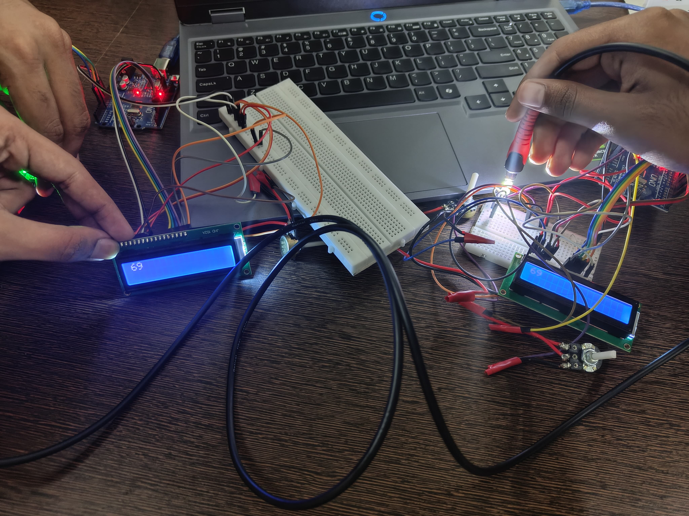

# 💡 Optical Fiber Data Link with Arduino

> A two-board optical communication system: a value set on a potentiometer is digitized, sent **bit-by-bit as light pulses through an optical fiber**, detected by an **LDR**, decoded and shown on a second LCD.


---

## 📑 Table of Contents
- [Overview](#-overview)
- [Features](#-features)
- [System Architecture](#-system-architecture)
- [Protocol](#-protocol)
- [Hardware](#-hardware)
- [Pinout](#-pinout)
- [Result](#-result)
- [Firmware](#-firmware)
- [Limitations & Future Work](#-limitations--future-work)

---

## 🔍 Overview

Optical fiber carries most of the world's data by switching light on and off. This project shows that principle at bench scale with two Arduino Uno boards, an LED, a plastic optical fiber and a light-dependent resistor. Built for the Engineering Physics lab (BPHY101P) at VIT Chennai.

## ✨ Features
- **Analog → digital → optical → digital → display** chain, end to end
- **8-bit payload** (0–255) transmitted serially with on-off keying (OOK)
- **Start-pulse synchronization**, so the receiver waits for the first light pulse before sampling
- **Two LCDs** show the transmitted and received values side by side for verification

## 🏗 System Architecture

```
 TRANSMITTER (Arduino Uno #1)                         RECEIVER (Arduino Uno #2)
 ┌───────────┐  ┌──────┐  ┌──────────┐   optical   ┌─────┐  ┌──────────┐  ┌───────────┐
 │Potentio-  │─►│ ADC  │─►│ 8-bit    │── fiber ───►│ LDR │─►│ threshold│─►│ binary →  │
 │meter (A0) │  │0–255 │  │ OOK LED  │  ~~~~~~~~~~ │ (A0)│  │ sampling │  │ decimal   │
 └───────────┘  └──┬───┘  └──────────┘             └─────┘  └──────────┘  └─────┬─────┘
                   ▼                                                            ▼
               LCD #1 (sent)                                            LCD #2 (received)
```

## 📡 Protocol

| Parameter | Value |
|---|---|
| Modulation | On-off keying: the LED is switched on or off for each bit |
| Frame | Start pulse + 8 data bits, MSB first |
| Bit period | ~600 ms |
| Receiver sampling | 200 ms after the start edge, then every 600 ms (mid-bit) |
| Detection | `analogRead(A0) < 50` is read as logic **1** |
| Throughput | ~1.6 bit/s |

## 🔩 Hardware

| Component | Qty |
|---|---|
| Arduino Uno | 2 |
| 16×2 character LCD (HD44780) | 2 |
| Potentiometer | 3 (input + 2 LCD contrast) |
| LED (transmitter) | 1 |
| Light-dependent resistor (LDR) | 1 |
| Plastic optical fiber cable | 1 |
| Breadboards, jumper wires | — |

## 📌 Pinout (receiver)

| Signal | Arduino pin |
|---|---|
| LDR divider output | A0 |
| LCD RS | D12 |
| LCD EN | D11 |
| LCD D4–D7 | D5, D4, D3, D2 |

## 🖼 Result

The value **69** set on the transmitter is received and displayed correctly on the receiver LCD:



## 💾 Firmware

The receiver sketch was adapted from a public tutorial by **[Carbon Coil](https://www.youtube.com/@CarbonCoil)**. That code is marked *"All rights reserved"*, so it is **not redistributed here**; see the original tutorial for the code.

## 🚀 Limitations & Future Work
- [ ] Write original transmitter and receiver firmware and add it to this repo
- [ ] Replace the LDR (slow response) with a **photodiode or phototransistor** to raise the bit rate from ~1.6 bit/s to kbit/s
- [ ] Add a stop bit and parity check for error detection
- [ ] Use **Manchester encoding** for clock recovery instead of fixed delays
- [ ] Use a hardware UART over light (IrDA-style) for continuous streaming

---
**Author:** Balaji T · B.E. ECE, VIT Chennai · [GitHub](https://github.com/Balaji3476)
